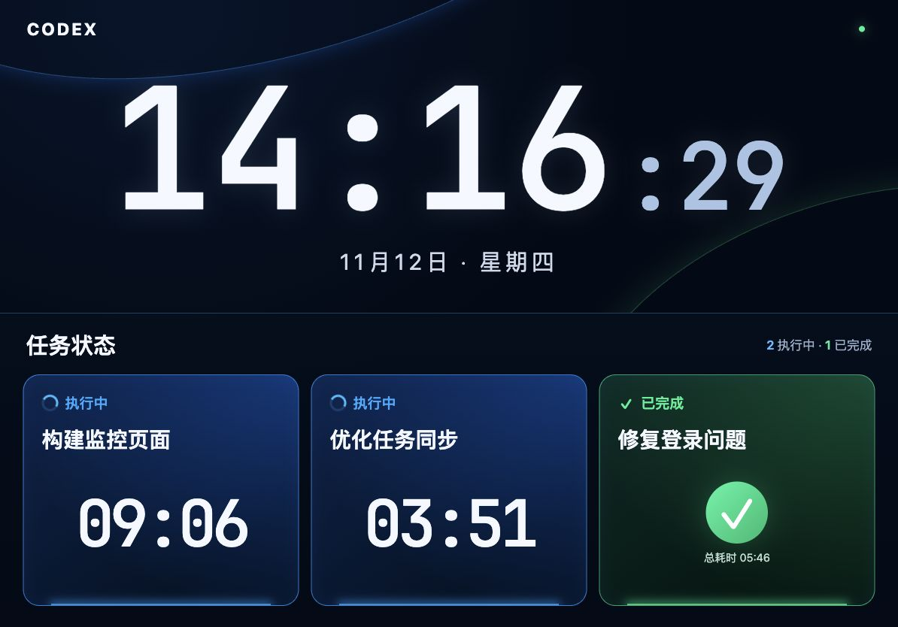

# Codex Monitor

[简体中文](README.md) · [English](README.en.md)

A local dashboard that shows your Mac's Codex tasks on an iPad: a large clock above blue running cards and green completion cards. When a task finishes, an eight-second notification brings its name and a large checkmark to the foreground.

The backend uses Python's standard library. The frontend runs without a build step, and its bundled font loads from your Mac.

## Preview

Both screenshots use fictional tasks and contain no real task data.

Everyday running view:



Completion notification:


## Features

- Large clock with locally hosted JetBrains Mono numerals.
- Running timers based on lifecycle timestamps, rather than when you opened the page.
- Separate completed, interrupted, failed, and unconfirmed states.
- Eight-second completion effects, with multiple completions grouped together. Existing completed tasks do not replay their effects on page load.
- Landscape and portrait layouts, two-line task titles, responsive timers, and horizontal card scrolling.
- Automatic reconnection, with dimmed cards and paused timers while disconnected.
- Persistent completion records and per-browser clearing.
- Optional macOS login startup through a user LaunchAgent.

## Requirements

- A Mac running Codex with local session logs and `~/.codex/state_5.sqlite`.
- Python 3.10 or later. The backend has been tested with Python 3.10.7.
- An iPad with a modern browser on the same local network as the Mac.
- macOS `lsof` and `launchctl`, used for writer detection and background startup.

Node.js is optional and used only for the JavaScript syntax check below. No Python packages or frontend dependencies need to be installed.

## Quick start

Clone the repository and start the background service from its root:

```sh
git clone https://github.com/100days-YongLin/codex-monitor.git
cd codex-monitor
python3 scripts/service.py start
```

Open [http://localhost:8790/](http://localhost:8790/) on the Mac. On the iPad, open `http://<MAC_LAN_IP>:8790/` in Safari, replacing `<MAC_LAN_IP>` with the Mac's local IP address. You can find it in macOS System Settings under the active network connection's details.

In Safari, choose **Share → Add to Home Screen** for a standalone display. Keep the Mac awake and connected. Screen Wake Lock is not guaranteed over local HTTP; adjust the iPad's Auto-Lock setting if you need an always-visible display.

## Controls and task states

Click **CODEX** in the top-left corner to open the controls. **清除已结束** clears finished cards in this browser; **切换全屏** requests fullscreen where supported. A connection dot is green when connected and orange when disconnected. Hover over it to read its status.

| Card | Meaning |
| --- | --- |
| Blue | A start event exists, and a local process still holds the thread's writer handle. The timer shows elapsed minutes and seconds. |
| Green | A completion event was received for this turn. The checkmark means the turn ended, not that its code passed tests. |
| Orange | The turn was interrupted, or its state cannot be confirmed because no completion event or live writer can be found. |
| Red | A failure event or failed terminal status was received. |

Running cards appear first. Each thread has one card for its latest turn. Scroll the card area horizontally to see additional tasks. Long titles wrap to at most two lines; hovering over a title reveals its full text on devices with pointer support.

The first scan includes finished tasks from the current day. Observed terminal records are then saved across service restarts in `.runtime/tasks.json`. Clearing cards stores their turn IDs in browser-local storage; a later turn in the same thread can appear again. Devices maintain their own cleared lists.

Completion notifications last eight seconds, can be dismissed with their close button or Escape, and restart their timer when another task completes during the notification. Failed and interrupted turns do not trigger a green notification. Reduced-motion preferences disable the animations.

## Service management

```sh
python3 scripts/service.py start
python3 scripts/service.py stop
```

Starting installs a user LaunchAgent, starts the service, and enables login startup and restart after exit. Starting an already-loaded service restarts it. Stopping unloads the service and removes its login-start configuration.

The repository also includes `启动监控.command` and `停止监控.command` as Finder shortcuts. Keep the checkout at the same path while its LaunchAgent is installed. Stop the service before moving the directory, then start it from the new location.

For foreground operation, stop the background service first:

```sh
python3 scripts/service.py stop
python3 -m monitor.server --host 0.0.0.0 --port 8790
```

Foreground options:

| Option | Default | Purpose |
| --- | --- | --- |
| `--host` | `0.0.0.0` | Listen on all interfaces for LAN access. Set `127.0.0.1` for Mac-only access. |
| `--port` | `8790` | HTTP listening port. |
| `--codex-home` | `CODEX_HOME`, or `~/.codex` | Codex directory containing the local database and logs. |

Service logs and retained task data live in the Git-ignored `.runtime/` directory. The LaunchAgent label is `local.koi.codex-monitor`.

## Data access and limitations

The monitor opens Codex's local metadata database in read-only mode and reads the JSONL files referenced there. It recognizes lifecycle events such as `task_started`, `task_complete`, and `turn_aborted`, and uses `lsof` to check thread writer handles. Snapshots refresh approximately every two seconds. It does not modify Codex files or make model requests.

This adapter depends on local Codex implementation details, rather than a public monitoring API. Codex updates may require adapter changes. It only covers tasks with local lifecycle logs on this Mac; other Macs, cloud-only tasks, and old threads whose logs are absent are outside its coverage. Approval and other interactive waiting states are not classified separately.

The HTTP API exposes task titles, project directory names, turn IDs, statuses, timestamps, and source diagnostics. It does not return chat bodies, tool output, or authentication files. The default server uses HTTP without authentication and is intended for a trusted LAN; anyone who can reach its listening port can read this metadata.

## Demos and checks

| Path | Behavior |
| --- | --- |
| `/?demo` | Example tasks without live polling. |
| `/?demo=stress` | Long Chinese and English titles, long timers, and additional cards. |
| `/?demo=celebrate` | An example task completes about two seconds after opening, triggering the notification. |

Run the lifecycle tests and optional frontend syntax check:

```sh
python3 -m unittest discover -s tests -v
node --check public/app.js
```

The lifecycle suite covers timestamps, interrupted and failed turns, new turns, partial log writes, large records, missing writer handles, and retained completion records after restart.

## Project structure

| Path | Responsibility |
| --- | --- |
| `monitor/source.py` | Read-only Codex adapter and retained task records. |
| `monitor/server.py` | Static files and the `/api/status` endpoint. |
| `public/` | Clock, cards, responsive styles, notifications, and bundled font. |
| `scripts/service.py` | macOS LaunchAgent installation and removal. |
| `tests/test_source.py` | Lifecycle and persistence tests. |
| `output/` | Interface screenshots. |

## Font attribution

[JetBrains Mono](https://github.com/JetBrains/JetBrainsMono) is bundled under the SIL Open Font License 1.1. Its license is included in [public/fonts/OFL.txt](public/fonts/OFL.txt). This license applies to the bundled font.
