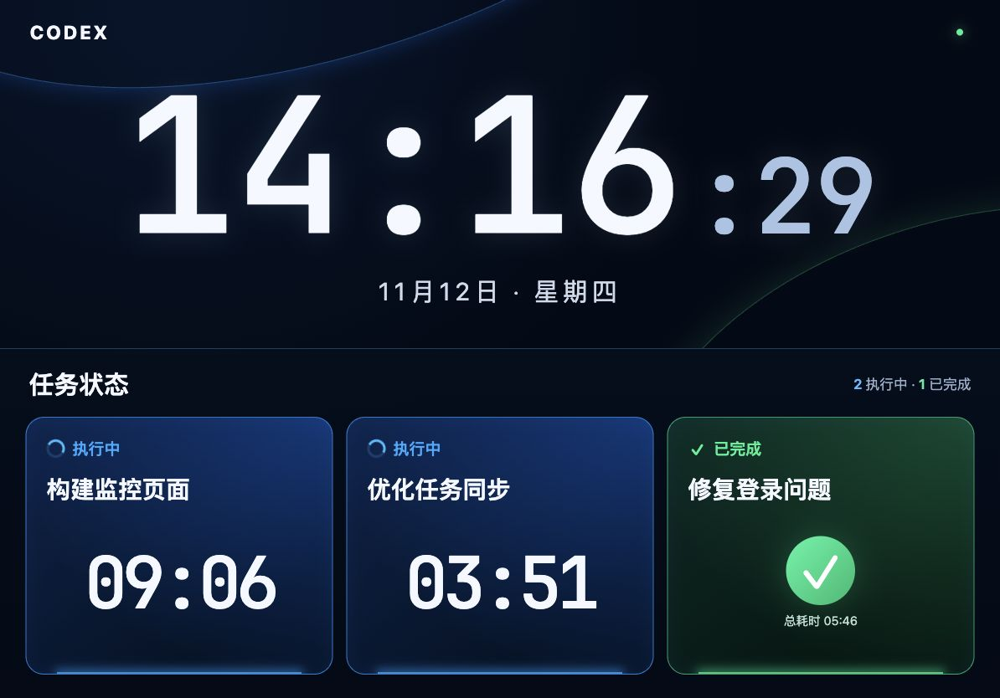

# Codex Monitor

[简体中文](README.md) · [English](README.en.md)

在 iPad 上查看 Mac 的 Codex 任务：上半屏是大时钟，下半屏是蓝色运行卡片和绿色完成卡片。任务完成时，任务名和大勾会弹到屏幕中央，持续提醒 8 秒。

后端仅使用 Python 标准库，前端无需构建，内置字体由 Mac 本地提供。

## 界面预览

以下截图均使用虚构任务，不包含真实任务数据。

日常运行状态：



任务完成通知：


## 功能

- 大时钟，数字使用本地托管的 JetBrains Mono 字体。
- 根据任务生命周期中的真实开始时间计时，不从打开页面时重新计时。
- 区分完成、中断、失败和状态待确认。
- 8 秒完成特效，多个完成任务合并展示；打开页面时不会重播历史完成记录。
- 适配横屏和竖屏，长标题最多两行，计时随空间缩放，卡片区独立横向滚动。
- 自动重连，断线时卡片变暗、运行计时暂停。
- 完成记录持久化，每个浏览器可以独立清除。
- 支持通过 macOS 用户级 LaunchAgent 登录后自动启动。

## 运行要求

- 运行 Codex 的 Mac，具备本机会话日志和 `~/.codex/state_5.sqlite`。
- Python 3.10 或更高版本。后端已在 Python 3.10.7 上测试。
- 与 Mac 位于同一局域网的 iPad，以及现代浏览器。
- macOS 自带的 `lsof` 和 `launchctl`，分别用于检测写入进程和管理后台服务。

Node.js 仅用于下方可选的 JavaScript 语法检查。无需安装 Python 包或前端依赖。

## 快速开始

克隆仓库，在项目根目录启动后台服务：

```sh
git clone https://github.com/100days-YongLin/codex-monitor.git
cd codex-monitor
python3 scripts/service.py start
```

Mac 上打开 [http://localhost:8790/](http://localhost:8790/)。在 iPad Safari 中打开 `http://<MAC_LAN_IP>:8790/`，将 `<MAC_LAN_IP>` 替换为 Mac 的局域网 IP。可在 macOS“系统设置”中查看当前网络连接的详细信息。

在 Safari 选择“分享 → 添加到主屏幕”，即可作为独立页面使用。Mac 必须保持唤醒和联网。局域网 HTTP 下不保证支持屏幕常亮；需要持续展示时，请调整 iPad 的自动锁定设置。

## 操作和状态

点击左上角 **⋯** 打开菜单。“清除已结束”用于隐藏当前浏览器的结束记录，“切换全屏”用于在浏览器支持时进入全屏。连接指示点正常时为绿色，断线时为橙色；支持鼠标的设备可悬停查看状态说明。

| 卡片 | 含义 |
| --- | --- |
| 蓝色 | 存在开始事件，且检测到本机进程仍持有该聊天的日志写入句柄。计时显示已运行的分钟和秒数。 |
| 绿色 | 收到这一轮执行的完成事件。勾表示本轮结束，不表示代码通过测试。 |
| 橙色 | 执行中断，或既没有结束事件，也无法确认写入进程仍存在，状态待确认。 |
| 红色 | 收到失败事件，或结束事件中的状态为失败。 |

运行中的卡片排在前面，每个聊天显示最新一轮执行。一屏最多完整显示 8 个任务：横屏时 1～3 个排一行，4 个排两行两列，5～6 个排两行三列，7～8 个排两行四列；竖屏时最多两列。超过 8 个可在卡片区横向滑动查看。标题和计时随卡片空间缩放，长标题最多显示两行；支持鼠标的设备可悬停查看完整标题。

首次扫描会载入当天已结束的任务。此后观察到的结束记录保存在 `.runtime/tasks.json`，服务重启后仍可保留。清除卡片会将对应轮次 ID 存入当前浏览器的本地存储；同一聊天的新一轮执行仍会出现。不同设备分别维护清除记录。

完成通知保持 8 秒，可点击关闭按钮或按 Escape 提前收起。通知期间有其他任务完成时，合并展示，并从最近一次完成重新计时。失败和中断不触发绿色通知。系统启用减少动态效果时，会关闭动画。

## 服务管理

```sh
python3 scripts/service.py start
python3 scripts/service.py stop
```

启动命令会安装用户级 LaunchAgent，立即启动服务，并启用登录后自动启动和退出后重启。服务已加载时，再次启动会重启服务。停止命令会卸载服务并移除登录启动配置。

也可以在 Finder 中双击仓库内的 `启动监控.command` 或 `停止监控.command`。LaunchAgent 安装期间请保持项目目录路径不变；如需移动，先停止服务，移动后在新目录启动。

需要前台运行时，先停止后台服务：

```sh
python3 scripts/service.py stop
python3 -m monitor.server --host 0.0.0.0 --port 8790
```

前台运行参数：

| 参数 | 默认值 | 用途 |
| --- | --- | --- |
| `--host` | `0.0.0.0` | 监听所有网卡，允许局域网访问。仅在 Mac 本机使用时可设为 `127.0.0.1`。 |
| `--port` | `8790` | HTTP 监听端口。 |
| `--codex-home` | `CODEX_HOME`，未设置时为 `~/.codex` | 存放 Codex 本地数据库和日志的目录。 |

服务日志和任务缓存保存在 Git 忽略的 `.runtime/` 目录。LaunchAgent 标签为 `local.koi.codex-monitor`。

## 数据访问和限制

监控服务以只读模式打开 Codex 本地元数据库，读取数据库指向的 JSONL 日志，根据 `task_started`、`task_complete`、`turn_aborted` 等生命周期事件判断状态，并通过 `lsof` 检查聊天的写入句柄。快照约每 2 秒刷新一次。服务不会修改 Codex 文件，也不会发起模型请求。

适配器依赖 Codex 本地实现细节，不是官方对外的监控 API。Codex 升级后可能需要调整适配。仅覆盖这台 Mac 上具有本地生命周期日志的任务，不覆盖其他 Mac、纯云端任务或日志已经缺失的旧聊天。等待审批等交互状态尚未单独识别。

HTTP 接口返回任务标题、项目目录名、轮次 ID、状态、时间和数据源诊断信息，不返回聊天正文、工具输出或认证文件。默认服务使用未加认证的 HTTP，面向可信局域网；能够访问该监听端口的设备可以读取这些元数据。

## 演示和检查

| 路径 | 行为 |
| --- | --- |
| `/?demo` | 展示示例任务，不轮询真实状态。 |
| `/?demo=stress` | 展示长中文和英文标题、长计时和额外卡片。 |
| `/?demo=grid&count=8` | 展示 8 个虚构任务；可调整 `count` 检查 0～16 个任务的布局。 |
| `/?demo=celebrate` | 打开约 2 秒后，一个示例任务完成，触发完成通知。 |

运行生命周期测试和可选的前端语法检查：

```sh
python3 -m unittest discover -s tests -v
node --check public/app.js
```

生命周期测试覆盖时间戳、中断和失败、新一轮执行、日志部分写入、大记录、写入句柄缺失，以及服务重启后的完成记录保留。

## 项目结构

| 路径 | 职责 |
| --- | --- |
| `monitor/source.py` | 只读 Codex 数据适配和任务记录持久化。 |
| `monitor/server.py` | 静态文件和 `/api/status` 接口。 |
| `public/` | 时钟、卡片、响应式样式、完成通知和内置字体。 |
| `scripts/service.py` | macOS LaunchAgent 安装和移除。 |
| `tests/test_source.py` | 生命周期和持久化测试。 |
| `output/` | 界面截图。 |

## 字体许可

内置的 [JetBrains Mono](https://github.com/JetBrains/JetBrainsMono) 使用 SIL Open Font License 1.1，许可原文见 [public/fonts/OFL.txt](public/fonts/OFL.txt)。该许可适用于内置字体。
